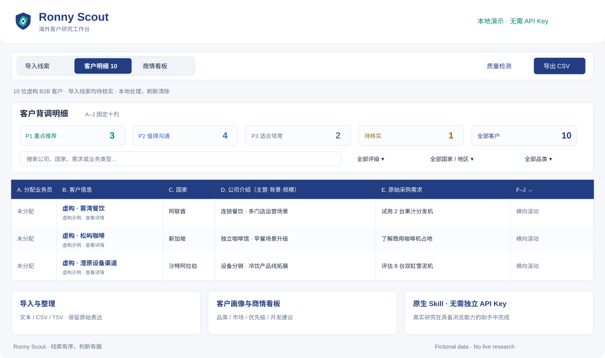

<picture>
  <source media="(prefers-color-scheme: dark)" srcset="https://raw.githubusercontent.com/RonnyMa-67/RonnyMa/a0fdc7eff2dff430a5f9664ca54a1c3610cdccf9/assets/hero-dark.svg">
  
</picture>

# Ronny · 外贸运营与 B2B 增长

**把流量、客户线索和跟进流程，连接成可执行的业务动作。**

我从事外贸与 B2B 数字营销，做过阿里国际站运营、商业设备出口及客户开发。日常关注的不只是获取询盘，更是弄清客户是谁、有什么需求，以及销售团队接下来能做什么。

借助 AI，我把运营经验整理成可复用的研究方法、工作流和工具原型，让客户信息更清晰，跟进更有依据。

**[查看代表作品](https://github.com/RonnyMa-67/RonnyMa/blob/main/projects/README.md)**　·　**[体验 Ronny Scout](https://ronnyma-67.github.io/RonnyMa/projects/ronny-scout/)**　·　**[查看公开 Skills](https://github.com/RonnyMa-67/RonnyMa/blob/main/skills/CHANGELOG.md)**

---

## 我关注的运营环节

| 方向 | 实践内容 |
| :--- | :--- |
| **B2B 数字营销** | 阿里国际站运营、Meta 推广思路、表单与询盘承接 |
| **客户开发与研究** | 海外企业背景、产品与业务匹配、公开信息核实、跟进切入点 |
| **线索与销售协同** | 线索字段整理、客户分配、跟进记录与 CRM 工作流程 |
| **AI 工作流** | 将业务判断和重复步骤整理为 Skills、表格规范与工具原型 |

## 代表作品：Ronny Scout

**从原始线索，到有依据的下一步。**

Ronny Scout 是一套面向 B2B 客户背调的 AI Skill：整理原始需求，研究公开企业信息，形成客户背景、合作潜力和建议行动，并输出统一的 A–J 客户研究表。

[在线体验](https://ronnyma-67.github.io/RonnyMa/projects/ronny-scout/) · [Skill 使用与源码](https://github.com/RonnyMa-67/RonnyMa/tree/main/skills/ronny-scout) · [下载 Skill ZIP](https://github.com/RonnyMa-67/RonnyMa/raw/refs/heads/main/skills/ronny-scout/skill.zip)

演示使用虚构客户，可浏览线索导入、客户明细和商情看板；演示本身不执行实时背调。实际研究需要安装 Skill，并使用具备浏览能力的 AI 助手；Skill 本身无需单独配置开发者 API Key。

## 公开 Skills

| Skill | 解决的问题 |
| :--- | :--- |
| [Ronny Scout](https://github.com/RonnyMa-67/RonnyMa/tree/main/skills/ronny-scout) | 整理已有线索，研究客户背景并生成统一研究表 |
| [B2B Customer Scout](https://github.com/RonnyMa-67/RonnyMa/tree/main/skills/b2b-customer-scout) | 从产品和目标市场出发，寻找并筛选潜在企业客户 |
| [Meta Promotion Ops](https://github.com/RonnyMa-67/RonnyMa/tree/main/skills/meta-promotion-ops) | 梳理 Meta 推广、素材、表单承接和执行交接 |

[查看图文更新记录与版本历史](https://github.com/RonnyMa-67/RonnyMa/blob/main/skills/CHANGELOG.md)

## 更多运营工具

| 作品 | 用途 | 当前形态 |
| :--- | :--- | :--- |
| [Ronny Intelligence](https://github.com/RonnyMa-67/RonnyMa/tree/main/projects/ronny-intelligence) | 多来源线索整理与客户资料管理 | 前端原型 |
| [LeadScope](https://github.com/RonnyMa-67/RonnyMa/tree/main/projects/leadscope) | 线索分配、跟进状态与导出 | 浏览器本地工具 |
| [外贸 CRM 小程序](https://github.com/RonnyMa-67/RonnyMa/tree/main/projects/trade-crm) | 客户记录与团队跟进 | 微信云开发原型 |

## 经历与工作方式

- **2022–2023 · 阿里巴巴国际站**：B2B 广告数据与商家运营实习。
- **2023–2024 · 商用厨房设备**：阿里国际站运营。
- **2024 至今 · 商业设备出口**：外贸运营、B2B 数字营销与 AI 辅助工具实践。
- **教育**：浙江工业大学，2023 届本科毕业。

我通常先从实际业务问题出发，梳理信息、判断标准和交接动作，再借助 AI 开发与迭代工具。公开项目中的客户示例均为虚构或替换后的演示数据。

## 交流与合作

欢迎交流 **外贸运营、B2B 获客、客户研究和 AI 工作流**。

[查看全部作品](https://github.com/RonnyMa-67/RonnyMa) · [发起项目交流](https://github.com/RonnyMa-67/RonnyMa/issues/new)
