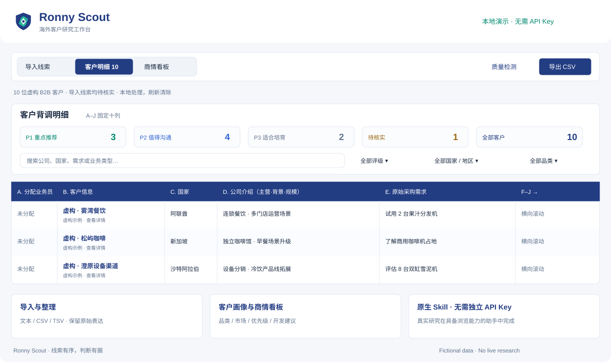

# Ronny Scout

**Turn raw business leads into clearer commercial decisions.**

Ronny Scout is a practical open-source workflow for multilingual B2B lead intelligence: form ingestion, company research, buying-signal analysis, structured evidence notes, qualification and export-ready spreadsheets.

### [Explore the interactive demo](https://ronnyma-67.github.io/RonnyMa/projects/ronny-scout/) · [Install native Skill · No API](../../skills/ronny-scout/references/no-api-quickstart.md) · [Source & Skill](../../skills/ronny-scout/) · [Creator profile](../../README.md)

**Try it in your own AI:** import the [Ronny Scout Skill folder](../../skills/ronny-scout/) (or its packaged `skill.zip`) into a Skills-compatible assistant and attach your leads. No external developer API key, server or paid integration is needed. Native web browsing is needed to check up-to-date company sites; native spreadsheet tools or optional free Python utilities create XLSX exports.

> **Demo notice:** All eight companies, people and transactions in the showcase are fabricated. The interface runs locally in the browser with embedded synthetic data. Filtering, record selection and sample CSV export work; external company lookups, authentication and CRM sync are *not connected* in the demo.

## What it demonstrates

| Workflow | Live demo experience |
| --- | --- |
| Lead workspace | Search by company, country or product interest; filter by P1/P2/P3 |
| Company intelligence | View structured identity, main business, context and scale |
| Buying signals | Review sample procurement intent and commercial opportunity |
| Next-best action | See concise, product-specific outreach angles |
| Export | Download filtered fictional leads as CSV |
| Research standards | See the [source-aware skill](../../skills/ronny-scout/SKILL.md), including formatting checks and evidence integrity |

## Why the distinction matters

A source-backed business lead profile is different from a generic marketing summary. The full workflow preserves original customer inputs, distinguishes reliable evidence from candidate associations, produces usable business context and checks template alignment before delivery.

The **open-source implementation** and **interactive showcase** are visible for learning and reuse according to their respective licenses. The *Ronny Scout* product name and visual identity must not be used to imply an unauthorized official edition or endorsement; see [brand guidelines](./BRAND_POLICY.md). Public MIT-licensed versions retain their original license grants, including commercial use.

## Run the demo

Open [index.html](./index.html) in a browser or serve it with any simple local static server; no API keys, backend, payment method or production customer data are needed.

GitHub Pages is enabled. Publishing uses on this public repository using the \`main\` branch / root, the demo URL should be:

\`https://ronnyma-67.github.io/RonnyMa/projects/ronny-scout/\`

The interactive demo is published at the URL above.

## Support the project

Open-source work is sustained by people who find it useful. [GitHub Sponsors](https://github.com/sponsors/RonnyMa-67) enrollment is being configured and the repository has a sponsor declaration in `.github/FUNDING.yml`; **donations are not available until the creator's Sponsor profile is approved and payout details are completed**.

Copyright © 2026 Ronny Scout contributors. No real customer information or proprietary account details are distributed in the showcase.
