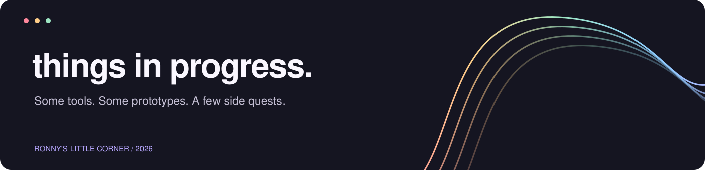

<div align="center">



**[简体中文](README.md) · English**

</div>

# 🌱 Trade CRM

**A customer record should come with a next step.**

A WeChat cloud-development mini-program prototype. I shaped customer fields, team responsibilities, and daily follow-up needs, with AI-assisted development. Leads become customer records with an owner, stage, and next contact date.

## 🧭 What's in the code

- Today's follow-ups, customer list, details, and team management.
- Customer stage, owner, next follow-up date, and timeline.
- Cloud functions for identity, team scope, roles, and write-operation logs.
- An Excel-to-database JSON utility and a scheduled-reminder template.

## 🛠️ Setup

Requires WeChat DevTools, your own mini-program AppID, and a cloud-development environment.

1. Import this directory. Set AppID in `project.config.json` and the cloud environment ID in `app.js`.
2. Create `teams`, `members`, `customers`, `followups`, and `audit_logs`. Limit database read/write access to administrators and use cloud functions.
3. Deploy `cloudfunctions/crm`, create a team, and verify role and team isolation.
4. For reminders, configure your subscription-message template before deploying `dailyReminder`. Repository values are templates.

```bash
python3 -m pip install -r requirements.txt
python3 tools/xlsx_to_json.py /path/to/your-demo.xlsx --team-id=YOUR_TEAM_ID
```

Converted output goes into ignored `data/`. See `COLUMNS` in the script for fields. `examples/customer-demo.json` is fictional; replace its team ID before testing.

## 📎 Current status

A prototype awaiting deployment validation, without a running WeChat cloud environment. Device, subscription-message, and production permission tests were not performed. Verify team and role isolation in your own environment. No PI quotation feature, real sales statistics, or private customer exports are included.

---

[🏠 Home](https://github.com/RonnyMa-67/RonnyMa/blob/main/README.en.md) · [📦 Skills](https://github.com/RonnyMa-67/RonnyMa/blob/main/skills/README.en.md) · [🧪 Projects](https://github.com/RonnyMa-67/RonnyMa/blob/main/projects/README.en.md)

🌈 A little at a time. See you around.
