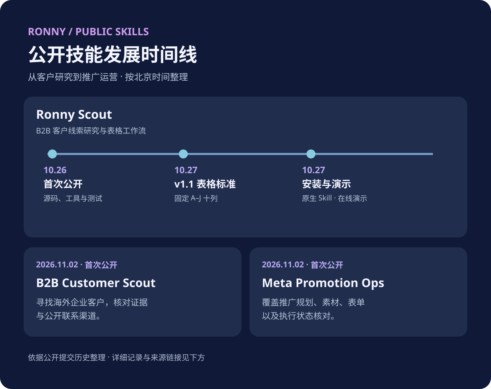

**简体中文** · [English](CHANGELOG.en.md)

# 公开 Skills 更新记录 / Public skills changelog

本记录根据公开仓库的提交历史补写，日期为北京时间（UTC+8）。这里的日期是提交日期，并不代表每项改动都有独立的正式发布或 GitHub Release。除已有记录明确使用的 v1.1 外，不为历史提交追认版本号。

## 2026-11-06 — 下载与使用反馈

- 三个公开技能提供独立 GitHub Release ZIP，分别记录附件累计下载次数；历史直链下载无法补计。
- 增加公开、自愿的使用反馈表单和入口，区分安装浏览与实际完成任务。
- 完成任务后可附一次简短反馈邀请；不自动提交反馈或回传任务资料。[下载与统计说明](README.md)

## Ronny Scout

### 2026-10-27 — 原生使用方式与演示
- 增加直接在支持浏览和文件工具的 AI 助手中安装、使用的说明；Skill 本身不要求单独的开发者 API key。[提交](https://github.com/RonnyMa-67/RonnyMa/commit/97e98ce2)
- 增加安装指南、可下载的 Skill ZIP 和演示入口。[安装指南](https://github.com/RonnyMa-67/RonnyMa/commit/aa8b8a77) · [ZIP 和入口](https://github.com/RonnyMa-67/RonnyMa/commit/955aa101)
- 相关演示工作台更新为线索导入、客户明细和商情看板三个页面，使用虚构示例；演示本身不执行实时背调。[提交](https://github.com/RonnyMa-67/RonnyMa/commit/38983232)

### 2026-10-27 — v1.1：固定 A–J 表格
- 统一十列客户研究表，保留原始需求，将联系方式和网站/社媒分别归入 F、G 列，并记录匹配分析、评级及下一步。
- 更新导出工具和兼容模板的安全追加工具，保留现有表格的后续销售字段；同步更新示例和测试。[导出与追加](https://github.com/RonnyMa-67/RonnyMa/commit/bdfa3e85) · [示例与测试](https://github.com/RonnyMa-67/RonnyMa/commit/202b760d)

### 2026-10-26 — 首次公开
- 发布可复用的 B2B 客户线索研究 Skill，随后补充源码、文档、工具、测试与 MIT 许可。[首次公开](https://github.com/RonnyMa-67/RonnyMa/commit/c145fcca) · [工具与测试](https://github.com/RonnyMa-67/RonnyMa/commit/fd1ae494) · [许可](https://github.com/RonnyMa-67/RonnyMa/commit/19577b6d)

## B2B Customer Scout

### 2026-11-02 — 首次公开
- 发布海外 B2B 潜在客户调研 Skill：结合产品规格或图片寻找企业，核对公开资料与联系人，整理可跟进的客户清单。
- 纳入去重、证据区分、拜访地点核实和反馈迭代等工作要求。[提交](https://github.com/RonnyMa-67/RonnyMa/commit/aef2c56c)

## Meta Promotion Ops

### 2026-11-02 — 首次公开
- 发布通用 Meta 推广运营 Skill，覆盖 Facebook / Instagram 的推广规划、素材、受众、预算、表单、消息承接和交接。
- 要求核对账户现状与实际保存状态，并区分草稿、审核、排期和投放状态。[提交](https://github.com/RonnyMa-67/RonnyMa/commit/cdbaedef)

后续更新可在对应 Skill 下按日期或正式版本号追加；提交历史见 [GitHub commits](https://github.com/RonnyMa-67/RonnyMa/commits/main/)。
