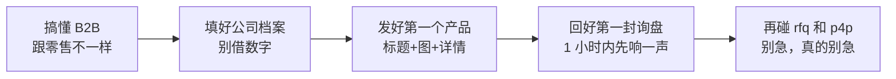
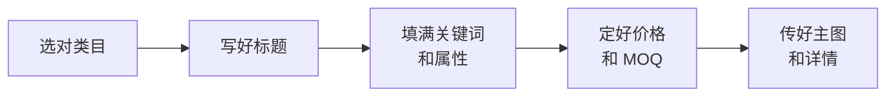
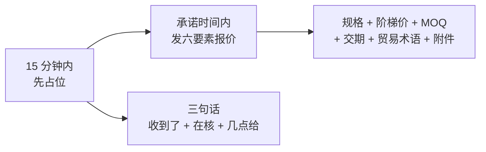
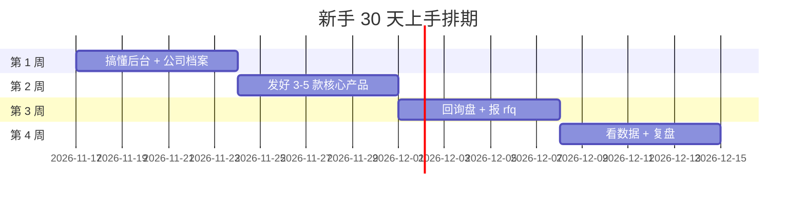

# 阿里国际站新手 SOP：从 0 到能上手

> 我是 Ronny，做 B2B 运营的。
> 这篇是写给新手的，先说好，跟进阶版分工不一样。进阶版默认你已经会发品、会回询盘了，这篇就是从 0 开始，手把手带你走到能上手。
> 别怕，国际站看着吓人，其实就几件事。一步一步来，真的，没那么难。

**这篇适合谁：** 刚接手国际站的新手运营，出口通 gold supplier 的饮料 / 机械设备工厂店，客户是进口商、分销商、批发商，不是终端用户。
**这篇不讲啥：** 进阶的翻修、重复链接改 sku、p4p 止损那些，去看进阶版。这篇先让你站稳，别摔跤。

---

## 0. 先说定位：新手先求对，再求快

新手最容易犯的错，就是一上来就想快。发一堆产品，开直通车，到处报 rfq，结果呢？链接错了，图错了，报价也错了，回头还得全返工。

所以，这篇的顺序就一个：先搞懂，再动手。动手了，就按清单一个一个勾。



---

## 1. 国际站到底是啥？跟零售不一样在哪

先想象这个画面，你就懂了：

```
零售平台，买家是这样买的：
┌──────────────────────────────────┐
│ 看图 → 看价格 → 下单 → 等快递     │
│ 1 件起买，当天发货               │
└──────────────────────────────────┘

国际站，买家是这样买的：
┌──────────────────────────────────┐
│ 搜产品 → 发询盘 → 问规格、问证书  │
│ → 谈 MOQ、谈价格、谈交期         │
│ → 打样 → 下大货 → 海运           │
│ 1 单，可能是几十台，几个月才成交  │
└──────────────────────────────────┘
```

不一样的地方，记这几条就行：

- **买家不是个人，是公司。** 进口商、分销商、批发商，他们买回去是要再卖的。所以，他们问的不是“好不好看”，是“能不能卖、能不能过海关、能不能长期供货”。
- **没有“一口价成交”这回事。** 价格是谈出来的，MOQ 是谈出来的，交期也是谈出来的。挂出来的价格，是个起点，不是终点。
- **MOQ，就是最小起订量。** 比如，MOQ 1 台，就是 1 台起卖；MOQ 10 台，就是 10 台起卖。写多少，就得能做到，别写 1 台，来了 1 台的单你又说做不了。
- **交期，就是从下单到发货要多久。** 打样要几天，大货要几天，旺季加不加时，提前写清楚。写了，就是承诺。
- **贸易术语，FOB、CIF 这些。** FOB，就是你在港口交货，后面的运费、保险买家管；CIF，就是你包到目的港。别搞混，搞混了就亏钱。

就这些。先记住，剩下的，边干边学。

---

## 2. 后台长啥样？第一次进后台，先点哪

后台第一次打开，肯定懵，按钮太多了。别慌，就记这几个地方：

```
My Alibaba 首页
├── 产品管理：发产品、改产品、下架，都在这
├── 数据管家：看曝光、点击、询盘，体检报告
├── 询盘管理：买家发来的询盘，TM 消息
├── RFQ 市场：买家的采购需求，每月 20 条报价权益
├── 旺铺装修：首页、分组、横幅，公司门面
└── 账号设置：权限、子账号，谁能改价、谁能回询盘
```

**新手第一天，干这五件事就行：**

1. 看一遍公司档案，哪里空着，哪里错了，先记下来，别急着改。
2. 看一遍在售产品，有多少条，哪些是重复的，哪些是零效果的，先数清楚。
3. 看一遍数据管家，我的效果，曝光、点击、反馈这三个数，现在是多少。
4. 看一遍询盘，最近 30 天，有多少条，回复率多少，有没有超时的。
5. 问清楚权限：谁能改价、下架、改预算、回询盘？离职的人，权限收回了没？

就这五件。干完，你对这个店，就有个大概的数了。

---

## 3. 公司档案怎么填？别借数字，别编

公司档案，就是买家第一次认识你的地方。填错了，后面全是麻烦。

### 档案长啥样？按这个顺序填

首页模块，我一般这么排，顺手：

```
banner（核心机型实拍 + 一句能交货的规格）
  ↓
执照、厂址
  ↓
生产线，带线号
  ↓
质检、试机
  ↓
研发，能改啥
  ↓
证书墙
  ↓
客户案例
  ↓
展会、仓库、发货
```

大厅、接待台、领导致辞、奖状墙，往后放，或者不放。买家不关心你大厅多大，关心你能不能交货。

### 三格，填的时候对着检查

- **执照格：** 全称和地址，对着实际生产的那座厂填。卖方主体和生产地不是一回事的，分两行写清。展厅门牌别抄进制造商栏，邻厂执照更别贴，贴了就是假档案。
- **产能格：** 写线号，加这一款能交的档。比如，“Line 1：某机型 / 产能；Line 2：某机型 / 产能；月产能多少台/月”。别写“月产十万”“行业最大”，买家会把这话当成你锁进交期的承诺。
- **证书格：** 只挂在有效期内、范围页对得上本款型号的。过期的、别的型号的、全厂通用包，先撤。这款没有，就写没有，别硬凑。

### 年限，别自己打自己脸

注册年限、出口年限、阿里年限、行业经验，这四个数，不是一回事。

顶部写一个数，公司介绍写另一个数，成立年份又是第三个数，买家一看就懵，到底几年啊？统一成一个口径，别自己打自己脸。

### 客户案例，没授权就别写大牌名

没书面授权，标题、主图、详情、品牌墙，都别放人家商标和 logo，聊天里说“能做某大牌同款”也不稳妥。

真供过货又不能公开的，就写“ OEM for international beverage brands (names withheld under NDA)”，或者只写地区加渠道。案例优先写能公开的事实：市场 + 渠道类型 + 机型 + 年份。

没依据的“服务 500+ 客户、出口 80+ 国家”，别写。没数字，就别硬编数字。

---

## 4. 发第一个产品：标题、关键词、属性、价格，一个一个来

发品这件事，拆开看，其实就五步：



### 第一步：选对类目，别放错地方

排序先排违规、再看类目相关，类目错了，后面全白搭。

类目怎么选？就看你的产品，到底是啥。雪泥机，就放雪泥机；果汁机，就放果汁机。别为了蹭流量，放到不相关的类目里，没用，还降权。

### 第二步：标题，按这个公式写

标题公式，背下来：

```
属性 / 产能 + 核心机型 + for 瓶型 / 场景 + with 关键认证 / 配置
```

举个例子，通用版的：

> Automatic 6000BPH Water Filling Machine for 500ml PET Bottles with CE & Food-Grade 304 Stainless Steel

数字换成你家真实的。别堆词，标题堆到买家读不懂，质量分上不去。

**标题三不要：**

- 不要堆砌词，读都读不懂的标题，没人点。
- 不要放内部代码、料号，买家搜不到，也看不懂。
- 不要放品牌词、盗图，轻则下架，重则关店。

### 第三步：关键词，每款填满 3 个，别写成一样的

关键词，来源就四个，交叉验一遍：

1. 平台热搜
2. 数据管家，我的词
3. p4p 后台
4. google 关键词工具

品牌词和违禁词，删掉。3 个关键词，别写成一样的，写一样的等于只写了一个。

### 第四步：价格和 MOQ，必须是真的

- **阶梯价：** 标品设满 4 档，非标用单一 FOB 区间价。能按国家单独设价，就设。
- **MOQ：** 写多少，就得能做到。别写 1，来了 1 台的单，你又说做不了。
- **假价格、假 MOQ，千万别碰：** $0.01–$100 区间价、MOQ 写 99999、一分钱引流。买家第一反应就是骗子，平台还降权。

### 第五步：主图和详情，传之前先检查

主图 6 张，详情四件套，具体在下一章讲。这里先记住两个数：

- 信息质量分，目标 4.5，底线 4.0。缺表格、正文太短、属性空项，逐项清零。
- 详情图，单张 ≤3M、≥600×600，图集总数 ≤30 张，统一 750px 宽。

---

## 5. 主图 1：绿色场景大图，别再白底了

我喜欢绿色主图的，就绿色打底，全店统一，买家在搜索结果里刷过去，一眼就认出是你家的图。

长这样，五件套齐了，才算数：

```
┌──────────────────────────────────────────────┐
│ 🟢🟢🟢  绿色主色打底，全店统一  🟢🟢🟢      │
│                                              │
│  YOUR LOGO                                   │
│                                              │
│  全自动饮料灌装线                            │
│  ── 一句话讲清：这机器，是干啥的 ──          │
│                                              │
│  ┌──────────┐ ┌──────────┐ ┌──────────┐    │
│  │ 产能徽章 │ │ 材质徽章 │ │ 认证徽章 │    │
│  │ 300杯/时 │ │ 304不锈钢│ │ CE · ISO │    │
│  └──────────┘ └──────────┘ └──────────┘    │
│                                              │
│  • 卖点短句一，落到买家好处上                │
│  • 卖点短句二，别自夸，说人话                │
│                                              │
│  ┌───────────────┐   ┌───────────────────┐  │
│  │ 机器本体      │   │ 成品饮料          │  │
│  │ 灌装头、面板  │ → │ 刚打出来的果汁    │  │
│  │ 都看得清清楚楚│   │ 颜色、气泡都在    │  │
│  └───────────────┘   └───────────────────┘  │
└──────────────────────────────────────────────┘
  绿色主色 + 五件套，徽章数字上线时，全换成本款真实参数。
  背景干净点，斑驳感轻点，太重了，看着脏，真的。
```

**几个新手最容易错的地方：**

- 徽章和卖点上的数字，只能用这款自己的真实参数。参考图上的数是参考图的，别整套抄过来。抄错一个数，后面整份报价都没人信。
- 生图最容易错在机器本体：控制面板的按钮形状和数量、指示灯、灌装头个数、柜门是开口的还是封死的，生成图经常给你画错。发之前，对着实物照片逐项核，有一项对不上，这张图就不能用。
- 尺寸数字别让 ai 标，买家撞见一次，就不再信你。
- 风格全店统一：所有款的主图 1，用同一套版式、同一个 logo 位置、同一种徽章样式。别一款一个颜色，看着像拼凑的店。

**尺寸守硬线：** 750×750 正方形，单张压到 500K 以内，主体占画面 70%–85%。平台底线是 6 张、jpg/png、单张 ≤5M、>640×640，少于 4 张质量分很难看。

白底图呢？往后放，别再占第一张了。第 2 张放干净角度的整机图就行。

**第 2–6 张分工，我一般这么排：**

| 第几张 | 放啥 |
|---|---|
| 第 2 张 | 干净角度的整机图，看清全貌就行 |
| 第 3 张 | 应用场景，机器在客户那边跑起来的样子 |
| 第 4 张 | 细节特写，灌装头、控制面板、气动件，挑最能证明做工的拍 |
| 第 5 张 | 尺寸图，数字必须实测，别估 |
| 第 6 张 | 包装图 + 证书 / 铭牌图，证书要跟后面那章的范围对得上 |

### 详情页：四件套缺一不可

- 参数表，放前面，买家先看参数再看故事。
- 场景图 + 工厂实拍，产线、试机、包装发货都要有。详情里只有产品图、没有交付证据，是“点击高、询盘低”最常见的原因，没有之一。
- 卖点按 FAB 写：先配置，再说这配置强在哪，最后落到买家能得到啥好处。就这个顺序，老外吃这套，别上来就自夸。
- FAQ，把买家反复问的写死：交期、电压能不能改、配件包不包、质保多久。省得每个询盘重答一遍，累不累啊。

**两个提醒：**

1. 出口通发品可能只能用旧版详情，用不了新版结构化详情。做模板之前，先去后台确认你家能用哪个编辑器，别照金品教程白忙。
2. 图片银行按“机型 / 场景 / 证书 / 工厂”建文件夹，文件名写机型 + 日期，别用 IMG_001，三个月后你自己都找不到。

视频就一句：主图视频 30–45 秒、≤100M，前 15 秒必须见整机在跑；前 15 秒拍厂门和致辞的，等于没拍。详情视频 ≤10 分钟、≤500M，放完整的试机过程。

---

## 6. 询盘怎么回？赢在第一封，不是赢在手快

手快只是入场券。欧美采购收到十几份报价，只甩价格表的，第一眼就划走了。

### 买家邮箱里，你的报价长这样

```
买家收件箱，同一天，十几份报价：
┌──────────────────────────────────────────────┐
│ 供应商 A：价格表一张，啥也没说               │ → 划走
│ 供应商 B：价格表一张 + 一句“请查收”          │ → 划走
│ 你：规格复述 + 实物图 + 六要素报价单          │ → 点开，回复
└──────────────────────────────────────────────┘
```

差就差在第一封，是不是把规格关掉了。

### 询盘速度，分三层记

- 目标：tm 询盘 1 小时内，先响一声。
- 底线：24 小时必回。超过 24 小时没回、买家又勾了匹配其他供应商，这条询盘自动转成 rfq 发给全平台，等于你亲手把客户送给同行。
- 只认平台内回复：私人邮箱回的，不计入平台数据。垃圾询盘 72 小时内拒绝掉，别让它拉低你的数。

### 第一封的结构，背下来

用买家原话复述一遍规格 → 附一张标了尺寸的实物图 → 按他的数量给 moq 和交期 → 价格写清基准和 incoterm → 结尾只留一个具体问题等他回。就问一个，问多了他懒得回。

### 跟进节奏，别断

报价当天 1 封；3 天后 1 封，附产线视频；1 周后聊他的目标市场；2 周后介绍新品或新设计；3 周后发公司动态或技术升级；之后每周 1 封。站内同步跟，能要到 whatsapp 就要。

---

## 7. RFQ 是啥？怎么报？

RFQ，就是买家发出来的采购需求。你去报价，买家来选。

### 先筛：2 分钟过五关，不过就放掉

1. 规格对得上吗：产能、瓶型、电压，你家真能做吗？
2. 证书覆盖得了吗：他要的市场准入，你是已获证还是只能送检？
3. 数量像真的吗：数量跟他公司体量对不对得上，明显套价的别陪跑。
4. 市场是不是你的目标市场？不是的，优先级往后放。
5. 信息全不全：连规格都不写的，先发一句确认，再决定要不要花权益。

报价权益每月 20 条，每月 1 号、15 号各发 10 条，心里要有本账。垃圾 rfq，举报成功能返还权益，别白白浪费。

### 两段式回复，别一段发完



第一段就三句话：收到了、正在核规格和交期、几点给完整报价。再顺手问一个关键确认。rfq 发布后大概 30 分钟是黄金窗口，先接住再说。

第二段六要素齐了才发，缺合规附件的，在安全要求高的 rfq 里经常直接出局；缺规格锚点的，后面全是退货和纠纷。六要素清单在话术模板那章，勾完再发。

---

## 8. P4P：新手别急着开，先把产品修好

进阶玩家不问“一天烧多少”，先问结构对不对。新手也一样，结构不对，烧多少都是学费。

**新手开 p4p 之前，先检查这三件事：**

- 产品信息全了吗？类目对不对、核心词在不在标题里、属性填没填满？
- 主图 1 是不是场景大图？点击率上不去，加价也没用。
- 详情页接得住吗？参数表、交付证据、faq，都有了吗？

这三件没做好，别开 p4p。开了，也是白烧钱。

**真要开了，第一周只许这样开：**

- 只绑 1 个能交货的 sku，只开 1 个计划。多开计划数据就乱了，你根本分不清是哪个词带来的询盘。
- 词表最多 3 串，全是买家原话。第一串抄询盘和 rfq 里买家真实搜过、写过的词；第二串是能交货的同义说法；第三串是目标国家常用的另一种叫法。凑满就停。
- 精确或者短语匹配，否词先加满。第一周别开广泛，它经常给你买来错的品。
- 预算权限先写死。日预算上限、单次点击上限，让财务书面定。谁能改预算也写死，就店长和财务。

排名是推广评分 × 出价，不是价高者得。推广评分 3 星以上才有资格进主搜索结果页。掉到 0–2 星，问题基本在产品信息匹配度，先修产品，别加价。

### 出问题对着这张表改，别瞎改

| 症状 | 病根 | 只改这一处 |
|---|---|---|
| 曝光高、点击低 | 主图 / 标题 / 价格 | 换主图 1，别动词 |
| 点击高、询盘低 | 详情页接不住 | 补参数表、交付证据、faq，别动出价 |
| 曝光低 | 出价低或者词没覆盖 | 先查词覆盖，再小步加价 |
| 有点击、没对上的询盘 | 词买错了人 | 看搜索词报告，错词当天停、当天加否 |

每天就看三样：搜索词报告、点击花费、对得上的询盘。别盯着全店流量看热闹，那数好看没用。

---

## 9. 证书基础：先办哪几个？怎么分两栏？

证书这章，新手就记三件事，够了：

### 第一件：先分清三类，别混为一谈

- **体系证：** 比如 ISO 9001，证明你工厂的管理体系是规范的。
- **产品证：** 比如 CE，证明这款产品符合某个市场的准入要求。
- **市场准入：** 比如 FDA 食品接触合规，不是“FDA 证书”，常见的是注册。谁说能办一张 FDA 证书，多半是假的。

BSCI 是社会责任审核，不是产品证，别挂产品栏。自己实验室的报告不是市场准入证，拿出来反而露怯。

### 第二件：已获证 vs 可送检，永远分两栏

已获证，列证号 + 适用范围 + 有效期；还没拿到的，写清周期和费用，单独一栏。

“可做 CE”和“已获证”混着写，买家按已过证理解你，出事就是你的责任。“全球认证齐全”这种话直接删，没有一张证能覆盖全球。

### 第三件：优先级，按市场分

```
先办 ████████████████████  ISO 9001 · CE · FDA 食品接触
第二批 ██████████          UKCA · UL/CSA/ETL · SABER
按单追加 ████              ISO 22000 · LFGB · NSF · EAC · Halal
                          ↑ 哪个市场来单，办哪个，别提前撒钱
```

| 优先级 | 证书 | 市场 | 记牢这一句 |
|---|---|---|---|
| 先办 | ISO 9001 | 全球 | 体系底座，在有效期内，持有人跟店铺主体一致 |
| 先办 | CE（机械 + 食品接触） | 欧盟 | 没 CE 在欧盟不能合法卖和装。别拿零部件 CE 代替整机，DoC 不能缺 |
| 先办 | FDA 食品接触合规 | 美国 | FDA 不给普通产品发“证书”，常见的是注册 |
| 第二批 | UKCA | 英国 | CE 在英国认到啥时候，动手前查当期法规，别按旧消息干 |
| 第二批 | UL / CSA / ETL | 美国 / 加拿大 | 北美电气安全，都要年审 |
| 第二批 | SABER（PCoC + SCoC） | 沙特 | 强制。PCoC 按型号注册、有效期 1 年；SCoC 按批次 |
| 按单追加 | ISO 22000 / HACCP、LFGB、NSF | 食品买家 / 德国 / 美国 | 碰到连锁和大买家再补，别提前全办 |

### 过期了咋办

过期当天，撤勾 + 撤附件一起做。只撤勾、旧 PDF 还挂着，等于还在。

建总表，每月 1 号看一眼。字段：证书名 / 证号 / 持有人 / 适用机型与范围页 / 签发机构 / 生效日 / 到期日 / 负责人 / 状态。到期前 90 天启动续证。

---

## 10. 数据：出口通就看这几个地方，别看错地方

先纠正个大误会：数据参谋的市场、产品、选词、流量参谋是金品专享，出口通后台根本没有。为金品截图付费、照着排活，纯浪费钱。

出口通用下面这套：

- 数据管家 → 诊断中心：基础建站、推广引流、卖家沟通、订单转化四块，逐条做，这是全店体检报告。
- 数据管家 → 我的效果：看曝光 → 点击 → 反馈这条漏斗，哪环漏得狠补哪环。
- 数据管家 → 我的产品：高曝光低点击改主图标题，高点击低反馈改详情价格，高点击低曝光补关键词，有反馈低曝光就放大它。
- 数据管家 → 我的词 + 营销中心 → 关键词管理：这就是出口通版的选词。推广评分低于 3 星的就是没覆盖到的，补上。

### 全店漏斗，一眼看懂

```
曝光  ██████████████████████████████  10,000
点击  ██████                          1,200  (12%)
询盘  █                               36   (3%)
成交  ▏                               2    (5.5%)
```

每周就记三个数：曝光、点击率、询盘转化率。哪个连掉两周，只改它对应那一块，再看两周。别天天大动干戈，数据是用来定位问题的，不是用来焦虑的。

零效果产品：180 天零访客系统自动下架。等不到那时候，90 天没访客的就可以考虑自己删，慢慢删别断崖式全删，删完查一遍关键词覆盖，缺的补发。

---

## 11. 新手最容易踩的坑，汇总一下

- 假价格、假 MOQ：$0.01–$100 区间价、MOQ 写 99999、一分钱引流。买家第一反应就是骗子，平台还降权。
- 类目错放 + 标题堆砌 + 盗图蹭词：排序先排违规、再看类目相关，类目错了后面全白搭。
- 定制机挂 RTS：RTS 要求规格、价格、运费、MOQ、交期全真实、能直接下单，挂假了扣分、清退，严重的关店。设备大多是定制款，别挂。
- 信代运营包效果：国际站没有躺赚。代运营只能替你执行，选品、定价、谈判替不了。谁承诺“30 天出多少询盘、升到几星”，谁的话不可信。
- 重复铺货：同一款拆成十条近似链接，系统最后只展示一条，剩下的全沉底，还拖着店铺排名。不如一条链接里把规格用 sku 堆厚。详细做法看进阶版。
- 星等级算法这两年说法不一，别按任何人的“做某步加多少分”排工期，动手前看规则中心当期版本就行。

---

## 12. 第一个 30 天：新手排期，每天 1–2 小时

这不是进阶的翻修排期，是新手上手的排期。按周推进，别贪多。



### 第 1 周：搞懂后台，别急着改

- [ ] 后台五件事：公司档案、在售产品、数据管家、询盘、权限，逐项看完，记下来
- [ ] 规则中心截图存档：星等级版本、重复铺货、图片规范，看当期页，不认二手转述
- [ ] 公司档案三格检查：执照、产能、证书，哪格对不上，先记下来
- [ ] 证书总表建好：证书名 / 证号 / 持有人 / 适用机型 / 生效日 / 到期日 / 负责人 / 状态
- [ ] 数据基线：曝光、点击率、反馈数、零效果数，建好每周三数表

### 第 2 周：发好 3–5 款核心产品，一款一款来

- [ ] 只做 3–5 款，一款一款做透，别一次发 50 条
- [ ] 每款：类目对、标题按公式、3 个关键词、属性填满、价格和 MOQ 是真的
- [ ] 每款：主图 6 张补齐，主图 1 是绿色场景大图，验图后再上
- [ ] 每款：详情四件套，参数表、场景图、卖点、faq，缺一不可
- [ ] 信息质量分冲 4.5，守 4.0

### 第 3 周：回询盘，报 rfq

- [ ] 询盘有人值守，tm 1 小时首响、24 小时必回
- [ ] 第一封按五段式写，模板在下一章，直接抄，改上参数再发
- [ ] rfq 每天刷 1 天内的，先筛后报，精准的报，别见一条报一条
- [ ] 订阅 rfq 定制搜索，权益余额记账

### 第 4 周：看数据，复盘

- [ ] 每周三数：哪个连掉两周，只改对应那一块
- [ ] 清零复查：类目、重复、假价、过期证，全清了吗？
- [ ] 下月计划：核心款扩到几款、续证启不启动、p4p 开不开，开的话只开 1 个计划、1 个 sku
- [ ] 交接表一页写完：改了啥、发了啥、询盘情况、证书台账，附截图文件名和日期

**30 天过关线（只看过程，不承诺结果）：**

1. 公司档案三格真实可查，证书台账建好了
2. 3–5 款核心品发完了，质量分达标，主图 1 是场景大图
3. 询盘有人值守，tm 1 小时首响、24 小时必回
4. rfq 先筛后报，权益余额有账
5. 每周三数记下来了，知道哪环漏

询盘数、星级、排名，谁承诺谁不可信。真的，别信。

---

## 13. 话术模板：改上参数就能用

就一条用法：方括号全换成你家真实数再发，别原样群发，买家一眼能看出模板味。

### 模板 1 · 公司介绍（英文填空版）

> We are a manufacturer of [beverage filling / labeling / packaging equipment] in [City], China, with [XX] employees and 2 production lines.
> Line 1 produces [machine type, up to XXXX BPH]; Line 2 produces [machine type / capacity]. Our QC covers incoming material inspection, assembly checks, full-machine test runs and pre-shipment inspection reports.
> We hold ISO 9001 [certificate no., valid until YYYY-MM] and product certificates [CE certificate no. / scope; FDA food-contact compliance basis].
> We supply importers, distributors and wholesalers in [target markets]; we do not sell to end users.

哪句写不出真实数，哪句先删，拿到数再补。空着比编一个强。

### 模板 2 · 询盘第一封（五段式）

> Hi [Name], thanks for your inquiry.
> 1) Confirming your spec: you need [restate the buyer's requirement in their own words — capacity BPH / bottle type / voltage / market].
> 2) Attached is a photo of the actual machine with dimensions marked, plus the parameter sheet for this model.
> 3) For your quantity of [XX units]: MOQ is [X], lead time is [XX days] after deposit.
> 4) Price basis: FOB [Port], [price / range] — valid for [XX days].
> 5) One question so I can quote you precisely: [ask ONE specific thing]

第 5 段是钩子，只问一个问题。别一封把所有问题问完，没人愿意回小作文。

### 模板 3 · RFQ 第一段（15 分钟占位）

> Hi, we manufacture this type of equipment in-house (2 production lines), so we can match your spec directly.
> Received your RFQ — I am checking the spec, certificate coverage and production slot now, and will send the full quotation with datasheet and certificate copies by [time, e.g. 16:00 today, GMT+8].
> Quick check meanwhile: is your bottle [500ml PET] and voltage [380V/50Hz]?

这封就两个任务：让他知道你接住了，给他一个准点。承诺的时间必须守住，守不住别承诺。

### 模板 4 · RFQ 六要素报价清单（发之前勾一遍）

- [ ] 规格锚点：瓶型/产能 BPH、灌装头数、材质 304/316L、电压/PLC、适用瓶盖和标签
- [ ] 阶梯价：试样 / 小批 / 大货三档，写清币种、含不含税
- [ ] MOQ：能不能拆分、怎么拆
- [ ] 交期：打样天数 + 大货周期，旺季加不加时提前写
- [ ] 贸易术语与港口：FOB [港口] 或 CIF 目的港，谁订舱、谁买保险
- [ ] 合规附件：证书扫描件、测试摘要、包装方式、单箱体积和毛重

缺第 6 样，安全要求高的 rfq 经常直接出局；缺第 1 样，后面退货纠纷等着你。勾完再发。

---

## 出处：这套打法是从哪综合来的

不是拍脑袋写的，是把下面这些被卖家反复转发的分享和官方口径对齐之后，取共识、裁分歧，落到饮料设备这个品类上。

- Weiann《阿里国际站从 0 到 1》（2026-11-09）——核心品打法、数字优先、每周三数：https://www.weiann.com/2026/11/09/alibaba-store-zero-to-one-framework/
- 企丞 Aliad 系列——旺铺先改哪块、重复铺货只留一条、直通车第一周、RFQ 与信保：https://aliad.hk/article-wangpu-what-to-change-first
- Prosca《阿里巴巴国际站运营攻略 2026》：https://proscaapp.com/blog/alibaba-international-station-guidesx
- 52by 店铺诊断 / 云程从零开始：https://www.52by.com/article/191556
- Reytop 灌装机五大认证：https://www.reytop.com/5-essential-certifications-for-exporting-water-filling-machines-globally/
- 跨境销邦 2026 B2B 店铺评分 SOP：https://www.kuajingxiaobang.com/blog/cn-b2b-store-rating-2026/
- 阿里官方卖家指南：https://seller.alibaba.com/how-to-sell
- 出口通会员成长手册（语雀）：https://www.yuque.com/youyang-xo5vz/mygc51

提醒一句：语雀那本手册这次没打开，知乎和 GitHub 也没找到能核上数的高赞运营长文，这两处你回头自己对一下原文。星等级、P4P 预算这些数字各家说法不一样，我都没替你拍板，以规则中心和你家财务为准。

进阶版在隔壁：`skills/alibaba-sop/README.md`，等你把这篇的 30 天过关线走完了，再去看进阶版。

---

*Ronny，2026-11-17，写给刚接手国际站的新手运营。看完能直接动手，就够了。*
*公司名、客户名、型号、销量、曝光、价格都脱敏处理了，例子里的具体机型和数字都改成了通用说法，干货逻辑没动。*
