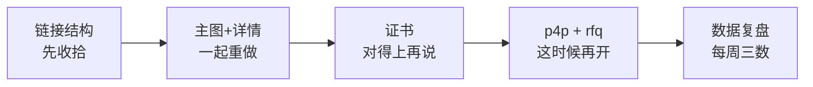
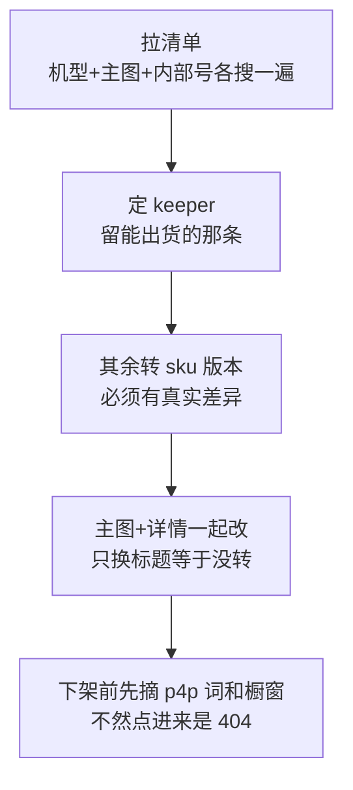
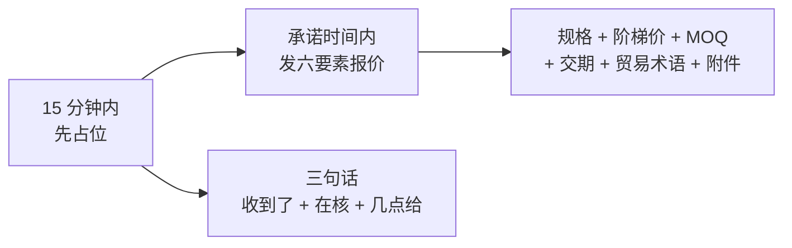
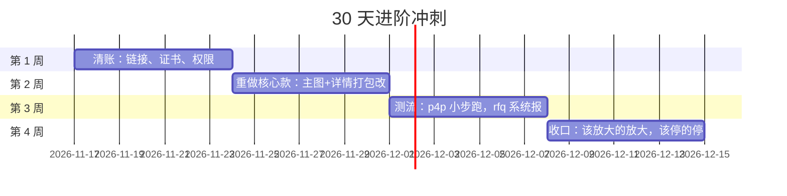

# 阿里国际站进阶 SOP：老店翻修碎碎念

> 我是 Ronny，做 B2B 运营的，25 岁，日常就是跟阿里国际站死磕。
> 这篇不是入门教程啊，先说好。默认你已经会发品、会回询盘、后台都摸过一遍了。
> 基础操作我一句不讲，全是进阶的活，就是那种——店开着呢，但就是起不来，你也不知道卡在哪了的那种。
> 反正我踩过的坑都在这了，你照着避就行，不用再自己摔一遍。

**这篇适合谁：** 出口通 gold supplier 的饮料 / 机械设备工厂店，客户是进口商、分销商、批发商，不是终端用户。
**不适合谁：** 刚开店啥都不会的，先去看官方那本语雀手册，回来再看我这篇。

---

## 先说定位，就一句话

会发品的人满大街都是，店做不起来一般不是不会操作。

是顺序反了、链接铺乱了、钱花早了。就这样。



顺序别反。反过来，钱买来的点击全落到错的链接、错的图上，复盘的时候你都不知道该怪词还是怪产品。

反正记住，先收拾屋子，再请客。

还有一句得放前面：金品那套数据参谋、验厂视频、迷你站，出口通没有。刷到攻略先看它讲的是哪一档，别拿金品的截图给出口通排活，排了也是白排，真的。

---

## 1. 链接别铺了，3–5 款做深就行

说真的，我以前也觉得铺得多 = 机会多，后来才发现不是。

同一款拆成十条近似链接，系统最后只展示买家最喜欢的那一条，剩下的全沉底，店铺还吃 7 天搜索排名靠后。你以为你在铺货，其实你在给自己降权，服了。

不如一条链接里把规格用 sku 堆厚。

### 重复链接咋办？别删，改成 sku 版本

这是现在最值钱的一章，真的，不骗你。

我们店当时一查：65 个型号，254 条重复。啥概念？就是同图同规格在线挂着好几条，看着热闹，其实没用。

正确做法就五步，我画给你：



**先判断，是真重复还是真不同款**

| 情况 | 咋办 |
|---|---|
| 图一样、规格一样，就标题换了几个词 | 真重复。只留一条，其余转 sku 版本 |
| 电压 / 容量 / 头数不一样，仓库里确实是两个内部编号 | 算不同货。可以留两条，但图、参数、标题必须真的不一样 |
| 就颜色或者小配件不一样 | 别新开链接，放进同一条的 sku 里就行 |
| 访客最高的那条，图却是另一个型号 | 别因为它数据好就留它。出库对不上，早晚出纠纷。留能指到库存的那条 |

**举个我自己的例子：**

- n2j1-01a，Compact 雪泥机爆款，主推月曝光 1422，1475 个销量。重复那条我没删，改成 N2J1-01B 机械款单一版本，标题改了，价格 $75.00，提交审核去了。主推一动没动。
- n2j1-01，重复那条改成 Black 黑色版，就颜色一个差异，写清就行。
- adl15lx1、adl15lx2，核对完发现重复全是已下架的，按规矩一条没碰。已下架的别管，别手贱。
- soybean，11 条全是已下架，也是跳过。真的，别碰下架的。

还有，清单得用主账号搜全店。子账号只能看见自己发的那几条，会少数，别被坑了。

**橱窗就 20 个，别浪费。** 第一位给核心机型，其余按搜索量和能不能交货排。交不了的款填进去，等于把曝光送给空气，这种事别干。

哦对，外面帖子流传的「重复铺货扣 6 到 12 分」这类数，在你自己后台对不上，别写进周报，也别拿它排活。就认一条：重复的只展示一条 + 店铺排名靠后，这就够你动手了。

---

## 2. 主图 1 别再白底了，真的过时了

我以前也以为主图 1 就得白底，干净嘛。后来发现不是，现在流行的是场景大图，就是电商主图 1 那种。

我喜欢绿色主图的，就绿色打底，全店统一，买家在搜索结果里刷过去，一眼就认出是你家的图。

长这样，五件套齐了才算数：

```
┌─────────────────────────────────┐
│ YOUR LOGO                       │
│                                 │
│  全自动饮料灌装线               │
│  一句话讲清：这机器是干啥的     │
│                                 │
│  [产能徽章] [材质徽章] [认证徽章] │
│                                 │
│  • 卖点短句一，落到买家好处     │
│  • 卖点短句二，别自夸           │
│                                 │
│  [机器本体 + 打出来的成品饮料]  │
└─────────────────────────────────┘
  绿色主色 + 五件套，徽章数字上线时全换成本款真实参数
```

**几个我踩过的坑：**

- 徽章和卖点上的数字，只能用这款自己的真实参数。参考图上的数是参考图的，别整套抄过来。抄错一个数，后面整份报价都没人信。
- 生图最容易错在机器本体：控制面板的按钮形状和数量、指示灯、灌装头个数、柜门是开口的还是封死的——生成图经常给你画错。发之前对着实物照片逐项核，有一项对不上，这张图就不能用。
- 尺寸数字别让 ai 标，1180mm 能给你标成 1200mm，买家撞见一次就不再信你。
- 风格全店统一：所有款的主图 1 用同一套版式、同一个 logo 位置、同一种徽章样式。别一款一个颜色，看着像拼凑的店。
- 背景干净点，斑驳感轻点。太重了看着脏，真的。
- 生意助手额度不够了咋办？那就我自己生，按同一个风格做，别自己凑合。

**尺寸守硬线：** 750×750 正方形，单张压到 500K 以内，主体占画面 70%–85%。平台底线是 6 张、jpg/png、单张 ≤5M、>640×640，少于 4 张质量分很难看。

白底图呢？往后放，别再占第一张了。第 2 张放干净角度的整机图就行。

**第 2–6 张分工，我一般这么排：**

| 第几张 | 放啥 |
|---|---|
| 第 2 张 | 干净角度的整机图，看清全貌就行 |
| 第 3 张 | 应用场景，机器在客户那边跑起来的样子 |
| 第 4 张 | 细节特写，灌装头、控制面板、气动件，挑最能证明做工的拍 |
| 第 5 张 | 尺寸图，数字必须实测，别估 |
| 第 6 张 | 包装图 + 证书 / 铭牌图，证书要跟后面那章的范围对得上 |

### 详情页：四件套缺一不可

参数表放前面，买家先看参数再看故事。场景图 + 工厂实拍，产线、试机、包装发货都要有。详情里只有产品图、没有交付证据，是「点击高、询盘低」最常见的原因，没有之一。

卖点按 FAB 写：先配置，再说这配置强在哪，最后落到买家能得到啥好处。就这个顺序，老外吃这套，别上来就自夸。

FAQ 把买家反复问的写死：交期、电压能不能改、配件包不包、质保多久。省得每个询盘重答一遍，累不累啊。

**两个提醒：**

1. 出口通发品可能只能用旧版详情，用不了新版结构化详情。做模板之前先去后台确认你家能用哪个编辑器，别照金品教程白忙。
2. 图片银行按「机型 / 场景 / 证书 / 工厂」建文件夹，文件名写机型 + 日期，别用 IMG_001，三个月后你自己都找不到。

视频就一句：主图视频 30–45 秒、≤100M，前 15 秒必须见整机在跑；前 15 秒拍厂门和致辞的，等于没拍。详情视频 ≤10 分钟、≤500M，放完整的试机过程。

**主图 + 详情一起改，别分开改。** 一款的主图、详情、参数表同一次做完，做完一款再下一款。每个裂变的 sku 先优化一张主图，主推那条要整体优化全部。就这样。

---

## 3. p4p：先锁结构，再谈钱

进阶玩家不问「一天烧多少」，先问结构对不对。结构不对，烧多少都是学费。

### 第一周，只许这样开

- 只绑 1 个能交货的 sku，只开 1 个计划。多开计划数据就乱了，你根本分不清是哪个词带来的询盘。
- 词表最多 3 串，全是买家原话。第一串抄询盘和 rfq 里买家真实搜过、写过的词；第二串是能交货的同义说法；第三串是目标国家常用的另一种叫法。凑满就停。厂名拼音、料号、证书号别放进来。
- 精确或者短语匹配，否词先加满。第一周别开广泛，它经常给你买来错的品。交不了的先否掉，跑起来发现错词当天就加否，别攒到周末。
- 预算权限先写死。日预算上限、单次点击上限，让财务书面定。谁能改预算也写死，就店长和财务。

词的大方向供参考：核心词大概两成、精准长尾大概六成、趋势词大概两成。场景词、应用词往往比纯产品词便宜，询盘质量还更高，可以多试。

具体预算数各家说法差太多，从 100–300 到 200–500 的都有，别抄，用你家财务能承受的上限跑通流程才是正经的。

### 星级低，先修产品，别加价

排名是推广评分 × 出价，不是价高者得。推广评分 3 星以上才有资格进主搜索结果页。掉到 0–2 星，问题基本在产品信息匹配度：先查类目对不对、核心词在不在标题里、属性填没填满。

顺序搞反，加价就是给平台送钱。

### 出问题对着这张表改，别瞎改

| 症状 | 病根 | 只改这一处 |
|---|---|---|
| 曝光高、点击低 | 主图 / 标题 / 价格 | 换主图 1，别动词 |
| 点击高、询盘低 | 详情页接不住 | 补参数表、交付证据、faq，别动出价 |
| 曝光低 | 出价低或者词没覆盖 | 先查词覆盖，再小步加价 |
| 有点击、没对上的询盘 | 词买错了人 | 看搜索词报告，错词当天停、当天加否 |

每天就看三样：搜索词报告、点击花费、对得上的询盘。别盯着全店流量看热闹，那数好看没用。

---

## 4. rfq + 询盘：赢在第一封，不是赢在手快

手快只是入场券。欧美采购收到十几份报价，只甩价格表的第一眼就划走了。

### 先筛：2 分钟过五关，不过就放掉

1. 规格对得上吗：产能、瓶型、电压，你家真能做吗
2. 证书覆盖得了吗：他要的市场准入，你是已获证还是只能送检
3. 数量像真的吗：数量跟他公司体量对不对得上，明显套价的别陪跑
4. 市场是不是你的目标市场：不是的，优先级往后放
5. 信息全不全：连规格都不写的，先发一句确认再决定要不要花权益

报价权益每月 20 条，每月 1 号、15 号各发 10 条，心里要有本账。垃圾 rfq 举报成功能返还权益，别白白浪费。

### 两段式回复，别一段发完



第一段就三句话：收到了、正在核规格和交期、几点给完整报价。再顺手问一个关键确认。rfq 发布后大概 30 分钟是黄金窗口，先接住再说。

第二段六要素齐了才发，缺合规附件的，在安全要求高的 rfq 里经常直接出局；缺规格锚点的，后面全是退货和纠纷。

### 询盘速度，分三层记

- 目标：tm 询盘 1 小时内先响一声。
- 底线：24 小时必回。超过 24 小时没回、买家又勾了匹配其他供应商，这条询盘自动转成 rfq 发给全平台——等于你亲手把客户送给同行。
- 只认平台内回复：私人邮箱回的不计入平台数据。垃圾询盘 72 小时内拒绝掉。

第一封的结构背下来：用买家原话复述一遍规格 → 附一张标了尺寸的实物图 → 按他的数量给 moq 和交期 → 价格写清基准和 incoterm → 结尾只留一个具体问题等他回。就问一个，问多了他懒得回。

跟进节奏：报价当天 1 封；3 天后 1 封，附产线视频；1 周后聊他的目标市场；2 周后介绍新品；3 周后发公司动态；之后每周 1 封。站内同步跟，能要到 whatsapp 就要。

---

## 5. 证书：进阶拼的是对得上

基础版教你填满，进阶版只看一件事：对得上吗。执照、产能、证书三格，哪格对不上，买家法务和平台人审都会追着问。进度条 90% 没用，对上才有用。

### 三格检查法

- **执照格：** 全称和地址对着实际生产的那座厂填。卖方主体和生产地不是一回事的，分两行写清。展厅门牌别抄进制造商栏，邻厂执照更别贴，贴了就是假档案。
- **产能格：** 写线号加这一款能交的档，比如「Line 1：机型 / 产能 BPH；Line 2：机型 / 产能 BPH；月产能 台/月」。别写「月产十万」「行业最大」，买家会把这话当成你锁进交期的承诺。
- **证书格：** 只挂在有效期内、范围页对得上本款型号的。过期的、别的型号的、全厂通用包，先撤。这款没有就写没有，别硬凑。

我自己的翻车现场，说出来你们乐乐：

- 319 那个数，我一开始以为是 319 个合规待更新，吓死了，结果一查是「爆品商机主题上新」，跟合规没关系。真的合规问题就 1 个：投币咖啡机，欧盟市场被屏蔽，要补欧盟 DoC。证书那边 6 个待上传 + 2 个过期 + 1 个验真失败，都要真实文件，做不了就是做不了，别硬编。
- 年份口径也翻过：顶部写 35+ 年，公司介绍写 30+ 年，成立又是 2016 年。买家一看就懵，到底几年啊？统一成一个口径，别自己打自己脸。
- 还有 9 个升优品，升不动，真不是我不想升，缺的都是真实询盘和下单，后台变不出来。广告投放要花钱，老客群发要你定对象和文案，这两样我没动。别信那种「一键升优品」的鬼话。

### 证书两栏分开写，这是底线

已获证 vs 可送检，永远分两栏。已获证列证号 + 适用范围 + 有效期；还没拿到的，写清周期和费用，单独一栏。

「可做 CE」和「已获证」混着写，买家按已过证理解你，出事就是你的责任。「全球认证齐全」这种话直接删，没有一张证能覆盖全球。

| 优先级 | 证书 | 市场 | 记牢这一句 |
|---|---|---|---|
| 先办 | ISO 9001 | 全球 | 体系底座，在有效期内，持有人跟店铺主体一致 |
| 先办 | CE（机械 + 食品接触） | 欧盟 | 没 CE 在欧盟不能合法卖和装。别拿零部件 CE 代替整机，DoC 不能缺 |
| 先办 | FDA 食品接触合规 | 美国 | FDA 不给普通产品发「证书」，常见的是注册。谁说能办一张 FDA 证书，多半是假的 |
| 第二批 | UKCA | 英国 | CE 在英国认到啥时候，动手前查当期法规，别按旧消息干 |
| 第二批 | UL / CSA / ETL | 美国 / 加拿大 | 北美电气安全，都要年审 |
| 第二批 | SABER（PCoC + SCoC） | 沙特 | 强制。PCoC 按型号注册、有效期 1 年；SCoC 按批次 |
| 按单追加 | ISO 22000 / HACCP、LFGB、NSF | 食品买家 / 德国 / 美国 | 碰到连锁和大买家再补，别提前全办 |

### 过期了咋办

过期当天，撤勾 + 撤附件一起做。只撤勾、旧 PDF 还挂着，等于还在。

只传正本。翻译件配一张中英文对照索引：证号、签发机构、范围页码、店铺文件名，外贸、认证、财务三边共用一张，别各存各的版本。

建总表，每月 1 号看一眼。到期前 90 天启动续证。

### 大牌名字别乱用

没书面授权，标题、主图、详情、品牌墙都别放人家商标和 logo，聊天里说「能做某大牌同款」也不稳妥。

真供过货又不能公开的，就写「OEM for international beverage brands (names withheld under NDA)」，或者只写地区加渠道。案例优先写能公开的事实：市场 + 渠道类型 + 机型 + 年份。没依据的「服务 500+ 客户、出口 80+ 国家」别写，没数字就别硬编数字。

顺带纠正俩误会：BSCI 是社会责任审核，不是产品证，别挂产品栏；自己实验室的报告不是市场准入证，拿出来反而露怯。

---

## 6. 首页和分组：我当时就是这么改的

这章全是我店里的实操，你直接抄作业就行。

当时首页顺序是：酒水机 → 咖啡/饮料机 → 雪泥机，果汁机连个独立专区都没有，混在下面。销量最高的 Compact 雪泥机，1475 个销量，5.0 分，居然在首页排第三组，产品页第一位还是按更新时间排的，不是按销量。

改完是这样：

**雪泥机 → 果汁机（新增）→ 酒水机 → 咖啡饮料机**

果汁机专区新增 3 个产品，第一位最后统一成 GLT4-02，就是 Commercial 4 Flavor 那款，组里唯一的优品，月曝光 319，是另外两款的 8 倍。第二位 4-Spout，第三位 58TL-3TF。

分组 24 个 → 17 个，删了 7 个空分组，未关联的 2 个归位了，新商品改成置顶。Compact 置顶到雪泥机第一位，GLT4-02 置顶到果汁机第一位。

YLT2-01 查到了，是台粉料机，在 Premix Powder 组，活着呢，就是标题里没写 YLT2-01 这个型号，所以选品器搜不到，不在果汁机专区是对的，别瞎加。

C 款那台咖啡机还错放在果汁机组里，我只往后移了，分组没动，等老板定去留。这种事别自己拍板。

还有个坑：主横幅还是 Gulfood 那张，展会都结束过期了，想换，横幅位要 1973×797 的宽图，备选图都是 1200×675，硬裁要裁掉约 28% 高度。得有一张宽图才能换，别硬裁。

顶部那个 35+ 也是，35+ 是做到店招图片里的，没有可编辑的文字，换「新店招」会丢掉产品图标、证书和联系人。得重做一张店招图才能改成 30+。这种就是看着小，动起来全是坑。

---

## 7. 数据：出口通就看这几个地方

先纠正个大误会：数据参谋的市场、产品、选词、流量参谋是金品专享，出口通后台根本没有。为金品截图付费、照着排活，纯浪费钱。

出口通用下面这套：

- 数据管家 → 诊断中心：基础建站、推广引流、卖家沟通、订单转化四块，逐条做，这是全店体检报告。
- 数据管家 → 我的效果：看曝光 → 点击 → 反馈这条漏斗，哪环漏得狠补哪环。
- 数据管家 → 我的产品：高曝光低点击改主图标题，高点击低反馈改详情价格，高点击低曝光补关键词，有反馈低曝光就放大它。
- 数据管家 → 我的词 + 营销中心 → 关键词管理：这就是出口通版的选词。推广评分低于 3 星的就是没覆盖到的，补上。

零效果产品：180 天零访客系统自动下架。等不到那时候，90 天没访客的就可以考虑自己删，慢慢删别断崖式全删，删完查一遍关键词覆盖，缺的补发。

每周就记三个数：曝光、点击率、询盘转化率。哪个连掉两周，只改它对应那一块，再看两周。别天天大动干戈，数据是用来定位问题的，不是用来焦虑的。

产品那边两个数顺手记一下：信息质量分目标 4.5、底线 4.0，缺表格、正文太短、属性空项逐项清零。

标题就按「属性/产能 + 核心机型 + for 瓶型/场景 + with 关键认证/配置」写，数字换成你家真实的。关键词每款填满 3 个、别写成一样的，品牌词和违禁词删掉。

---

## 8. 30 天进阶冲刺：接手老店的第一个月

这不是新手教学日程，是老店翻修的排期。每天 1–2 小时，按周推进。所有填空的数，第一周就向老板、厂长、财务书面要到，别估。



### 第 1 周：清账，不加预算，先把烂账清了

- [ ] 权限和合同：谁能改价、下架、改预算、回询盘，列清；离职号权限收回；年费到期日、橱窗 20 个、信保对公户主体，逐项对
- [ ] 规则中心截图存档：星等级版本、重复铺货、图片规范，看当期页，不认二手转述
- [ ] 重复链接清单：按机型 + 主图 + 内部号数清同图同规格几条，定 keeper 和转版本清单，橱窗第一位跟核心机型对不上当天换
- [ ] 证书清账：过期、邻款、全厂包当天撤勾撤附件；无授权品牌墙当天撤；建证书总表，90 天内到期的列续证负责人
- [ ] 数据基线：数据管家记曝光、点击率、反馈数、零效果数，建好每周三数表；询盘那边记近 30 天回复率和超时数，排好值班

### 第 2 周：重做核心款，只做 3–5 款，一款一款做透

- [ ] keeper 全套重做：标题、3 个关键词、属性填满、详情四件套、信息质量分冲 4.5 守 4.0
- [ ] 每个 sku 版本同步做：自己的主图 1（生意助手场景图，验图后再上）+ 自己的参数表，别只换标题
- [ ] 主图 6 张补齐，视频 30–45 秒、前 15 秒见整机运行；详情编辑器先确认新旧版本再做模板
- [ ] 橱窗 20 个排完：第一位核心款，其余按搜索量和可交货排
- [ ] 每款写好询盘首封模板，rfq 六要素报价单和两段式话术备好，订阅 rfq 定制搜索

### 第 3 周：测流，先测词，不加预算

- [ ] p4p 只开 1 个计划、1 个 sku、≤3 串词、精确/短语、否词加满，预算上限财务书面锁
- [ ] 每天看搜索词报告，错词当天停、当天加否；复盘当天不加预算
- [ ] rfq 每天刷 1 天内的，先筛后报，精准的报 10–20 条，权益余额记账
- [ ] 周复盘还是三数：哪个连掉两周，只改对应那一块

### 第 4 周：收口，用数据做决定，不用感觉

- [ ] 清零复查：类目、重复、假价、过期证全清了吗；90 天以上零效果慢慢删，删完补关键词覆盖
- [ ] p4p 结论：出过询盘的词留下放大，没数据的词停掉，别恋战
- [ ] 下月计划：核心款扩到几款、续证启不启动、要不要评估升金品——只有产线能接第三方验厂、证书原件齐、60 个橱窗吃得下才评估，不然继续把出口通做扎实
- [ ] 交接表一页写完：改了啥、下架清单、证书台账、p4p 计划编号和词表、模板，附截图文件名和日期。换人按表交，别口头交

**30 天过关线（只看过程，不承诺结果）：**

1. 三格和证书台账真实可查
2. 同图同规格只剩 1 条主链接，其余转成真版本
3. 3–5 款核心品质量分达标、橱窗第一位对得上
4. 询盘有人值守，tm 1 小时首响、24 小时必回
5. p4p 的计划、词表、花费、停词记录查得到
6. 违规和零效果有清零记录

询盘数、星级、排名，谁承诺谁不可信。真的，别信。

---

## 9. 话术模板：改上参数就能用

就一条用法：方括号全换成你家真实数再发，别原样群发，买家一眼能看出模板味。

### 模板 1 · 公司介绍（英文填空版）

> We are a manufacturer of [beverage filling / labeling / packaging equipment] in [City], China, with [XX] employees and 2 production lines.
> Line 1 produces [machine type, up to XXXX BPH]; Line 2 produces [machine type / capacity]. Our QC covers incoming material inspection, assembly checks, full-machine test runs and pre-shipment inspection reports.
> We hold ISO 9001 [certificate no., valid until YYYY-MM] and product certificates [CE certificate no. / scope; FDA food-contact compliance basis].
> We supply importers, distributors and wholesalers in [target markets]; we do not sell to end users.

哪句写不出真实数，哪句先删，拿到数再补。空着比编一个强。

### 模板 2 · 询盘第一封（五段式）

> Hi [Name], thanks for your inquiry.
> 1) Confirming your spec: you need [restate the buyer's requirement in their own words — capacity BPH / bottle type / voltage / market].
> 2) Attached is a photo of the actual machine with dimensions marked, plus the parameter sheet for this model.
> 3) For your quantity of [XX units]: MOQ is [X], lead time is [XX days] after deposit.
> 4) Price basis: FOB [Port], [price / range] — valid for [XX days].
> 5) One question so I can quote you precisely: [ask ONE specific thing]

第 5 段是钩子，只问一个问题。别一封把所有问题问完，没人愿意回小作文。

### 模板 3 · RFQ 第一段（15 分钟占位）

> Hi, we manufacture this type of equipment in-house (2 production lines), so we can match your spec directly.
> Received your RFQ — I am checking the spec, certificate coverage and production slot now, and will send the full quotation with datasheet and certificate copies by [time, e.g. 16:00 today, GMT+8].
> Quick check meanwhile: is your bottle [500ml PET] and voltage [380V/50Hz]?

这封就两个任务：让他知道你接住了，给他一个准点。承诺的时间必须守住，守不住别承诺。

### 模板 4 · RFQ 六要素报价清单（发之前勾一遍）

- [ ] 规格锚点：瓶型/产能 BPH、灌装头数、材质 304/316L、电压/PLC、适用瓶盖和标签
- [ ] 阶梯价：试样 / 小批 / 大货三档，写清币种、含不含税
- [ ] MOQ：能不能拆分、怎么拆
- [ ] 交期：打样天数 + 大货周期，旺季加不加时提前写
- [ ] 贸易术语与港口：FOB [港口] 或 CIF 目的港，谁订舱、谁买保险
- [ ] 合规附件：证书扫描件、测试摘要、包装方式、单箱体积和毛重

缺第 6 样，安全要求高的 rfq 经常直接出局；缺第 1 样，后面退货纠纷等着你。勾完再发。

### 模板 5 · 证书总表表头

```
证书名 | 证号 | 持有人 | 适用机型与范围页 | 签发机构 | 生效日 | 到期日 | 续证负责人 | 状态 | 店铺文件名
```

表格软件建好，每月 1 号过一遍，到期前 90 天标临期。

---

## 别踩的坑，汇总一下

- 假价格、假 MOQ：$0.01–$100 区间价、MOQ 写 99999、一分钱引流。买家第一反应就是骗子，平台还降权。
- 类目错放 + 标题堆砌 + 盗图蹭词：排序先排违规、再看类目相关，类目错了后面全白搭。
- 定制机挂 RTS：RTS 要求规格、价格、运费、MOQ、交期全真实、能直接下单，挂假了扣分、清退，严重的关店。设备大多是定制款，别挂。
- 信代运营包效果：国际站没有躺赚。代运营只能替你执行，选品、定价、谈判替不了。谁承诺「30 天出多少询盘、升到几星」，谁的话不可信。
- 星等级算法这两年说法不一，别按任何人的「做某步加多少分」排工期，动手前看规则中心当期版本就行。

---

## 出处：这套打法是从哪综合来的

不是拍脑袋写的，是把下面这些被卖家反复转发的分享和官方口径对齐之后，取共识、裁分歧，落到饮料设备这个品类上。

- Weiann《阿里国际站从 0 到 1》（2026-11-09）——核心品打法、数字优先、每周三数：https://www.weiann.com/2026/11/09/alibaba-store-zero-to-one-framework/
- 企丞 Aliad 系列——旺铺先改哪块、重复铺货只留一条、直通车第一周、RFQ 与信保：https://aliad.hk/article-wangpu-what-to-change-first
- Prosca《阿里巴巴国际站运营攻略 2026》：https://proscaapp.com/blog/alibaba-international-station-guidesx
- 52by 店铺诊断 / 云程从零开始：https://www.52by.com/article/191556
- Reytop 灌装机五大认证：https://www.reytop.com/5-essential-certifications-for-exporting-water-filling-machines-globally/
- 跨境销邦 2026 B2B 店铺评分 SOP：https://www.kuajingxiaobang.com/blog/cn-b2b-store-rating-2026/
- 阿里官方卖家指南：https://seller.alibaba.com/how-to-sell
- 出口通会员成长手册（语雀）：https://www.yuque.com/youyang-xo5vz/mygc51

提醒一句：语雀那本手册这次没打开，知乎和 GitHub 也没找到能核上数的高赞运营长文，这两处你回头自己对一下原文。星等级、P4P 预算这些数字各家说法不一样，我都没替你拍板，以规则中心和你家财务为准。

---

*Ronny，2026-11-17，写给已经懂基础、想进阶的老运营。看完能直接动手，就够了。*
*公司名、客户名都匿名处理了，数字全是自己店里跑过的或者留空等你填的，没编。*
